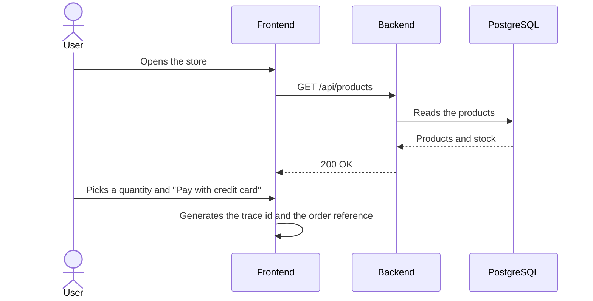
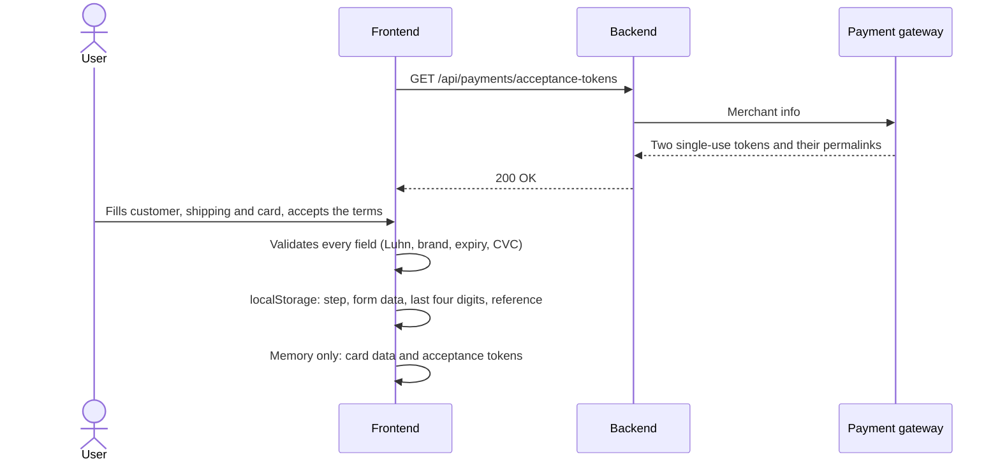
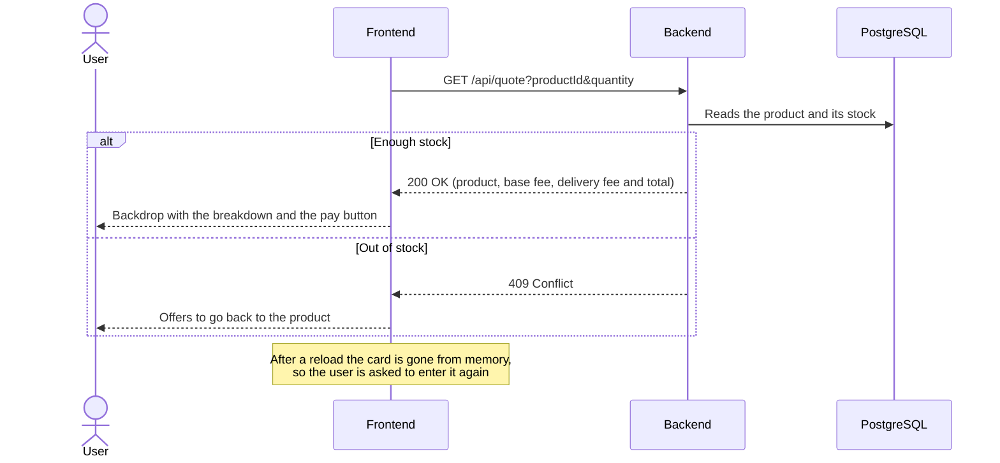
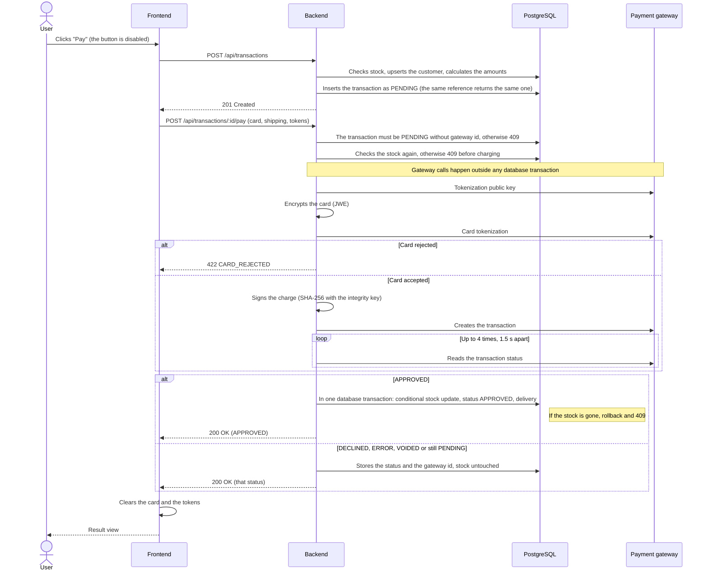
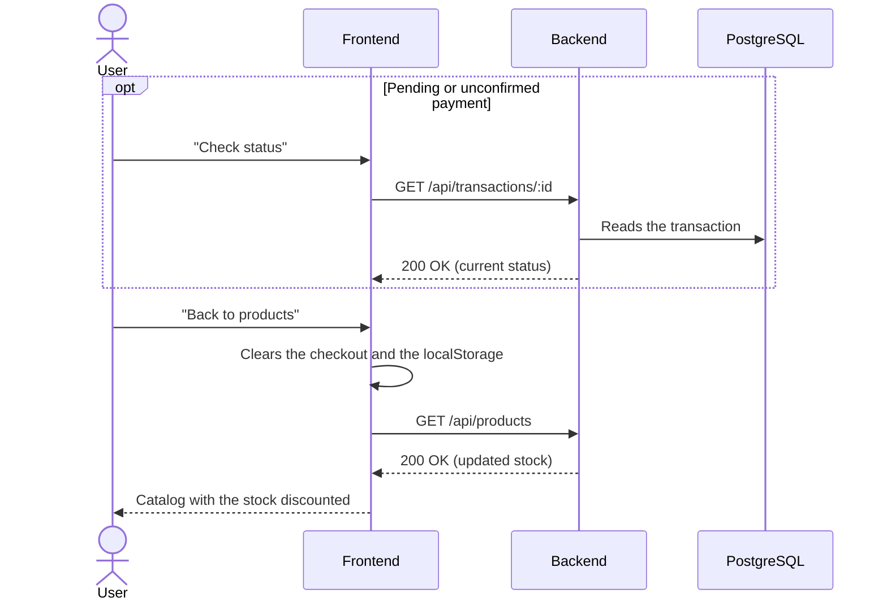
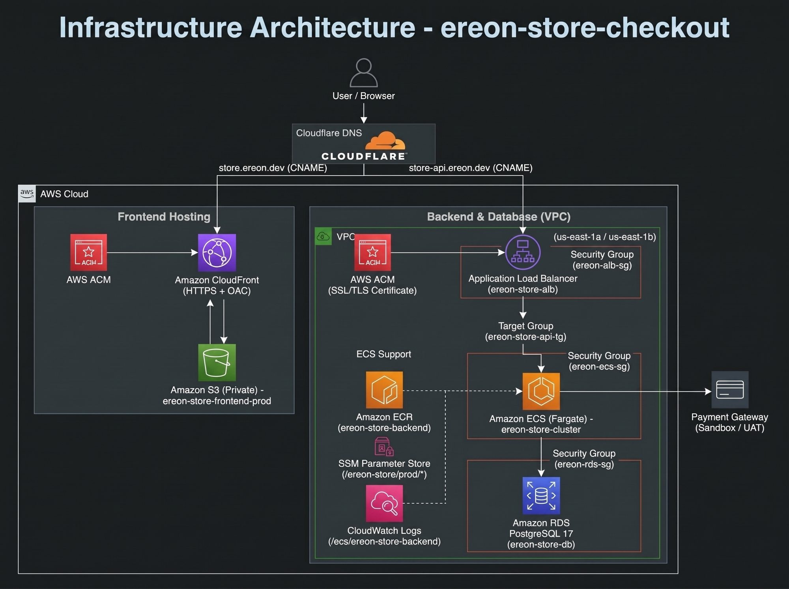
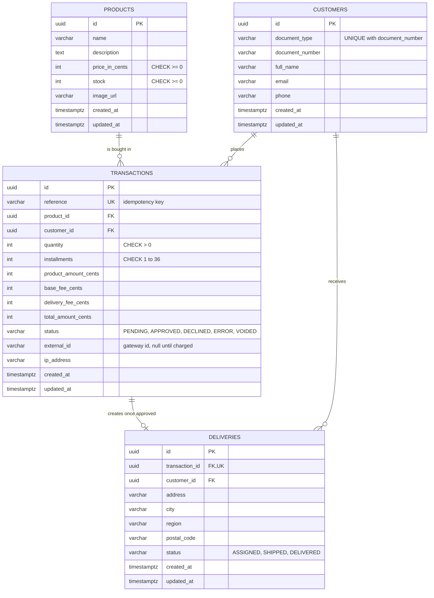
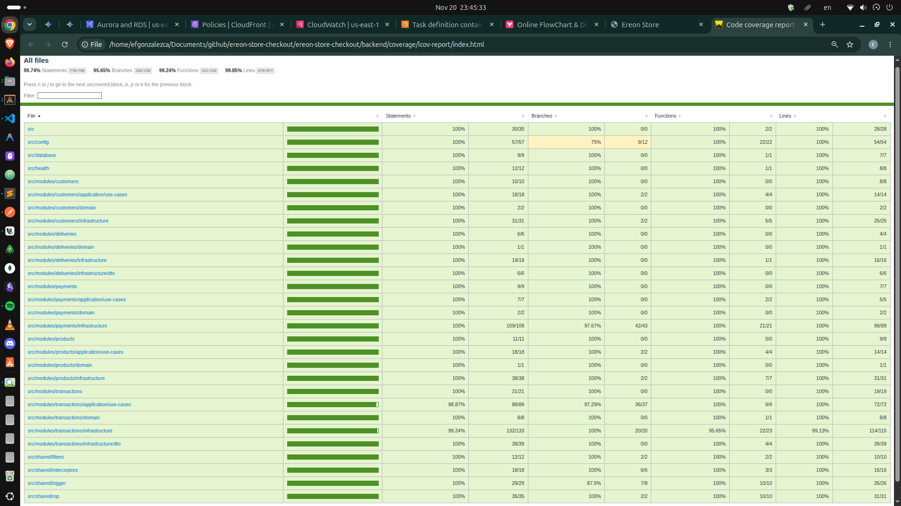
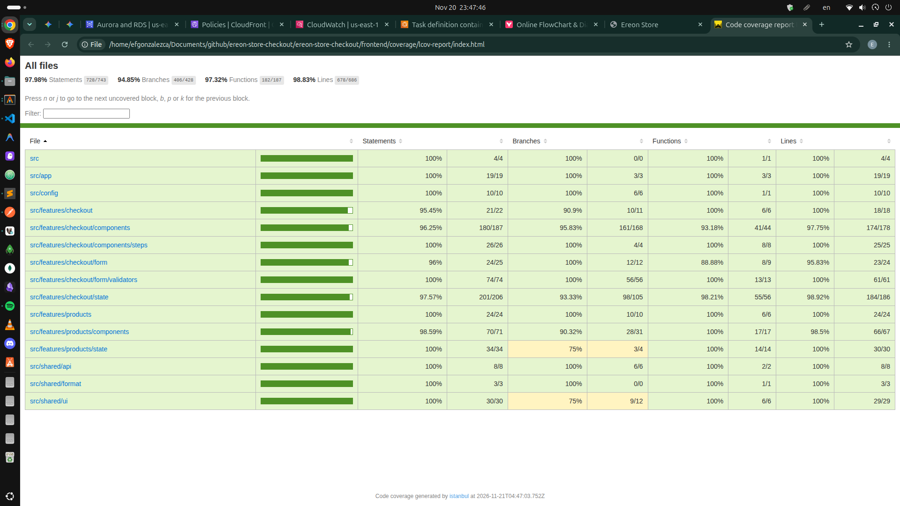

# ereon-store-checkout

Mobile-first e-commerce checkout SPA backed by a REST API. A customer buys a product with a credit card (sandbox mode) through a 5-step flow:

1. **Product page:** product details, stock and quantity selector.
2. **Card and delivery modal:** customer, shipping and card data with validation.
3. **Payment summary:** Material Design backdrop with the cost breakdown.
4. **Final status:** payment result (`APPROVED`, `DECLINED`, `ERROR`, `PENDING`, `VOIDED`).
5. **Back to the product page** with the stock updated.

| | URL |
| :--- | :--- |
| Frontend app | [https://store.ereon.dev](https://store.ereon.dev) |
| Backend API | [https://store-api.ereon.dev/api/health](https://store-api.ereon.dev/api/health) (health check) |
| API docs | [Postman collection](docs/postman_collection.json) |

---

## 1. Architecture and technical decisions

### Backend (NestJS)

Hexagonal architecture (Ports & Adapters): each module separates `domain/`, `application/use-cases/` and `infrastructure/`. Business logic never lives in controllers or repository adapters.

```text
backend/src/
├── config/        # environment validation
├── database/      # TypeORM connection, data-source, migrations and seeds
├── health/        # GET /api/health
├── modules/
│   ├── products/  # domain/, application/use-cases/, infrastructure/
│   ├── customers/ # same layers; upserts customers by document type and number
│   ├── payments/  # payment gateway port and adapter; acceptance tokens, card tokenization and charges
│   ├── transactions/ # creates PENDING transactions, quotes amounts and processes the payment
│   └── deliveries/   # delivery records created when a payment is approved
└── shared/
    ├── rop/          # Result<T, E> and typed domain errors
    ├── interceptors/ # ResultInterceptor
    ├── filters/      # GlobalExceptionFilter
    └── logger/       # JSON logger, trace id and redaction
```

**Railway Oriented Programming.** Use cases never throw for business rules; they return `Result<T, DomainError>` and chain steps with `map` / `flatMap`. Controllers return the `Result` as is, and a global `ResultInterceptor` maps it to HTTP:

| Domain error | HTTP |
| :--- | :--- |
| `NotFoundError` | `404` |
| `OutOfStockError`, `InvalidTransactionStateError` | `409` |
| `DuplicateReferenceError`, `CardRejectedError` | `422` |
| `GatewayError` | `502` |

A global `GlobalExceptionFilter` handles only unexpected errors: it logs them and answers `500` without exposing stack traces.

**Key decisions.**

| Decision | Why |
| :--- | :--- |
| Payment split in two endpoints: `POST /api/transactions` only writes to the database, and `POST /api/transactions/:id/pay` receives the card and calls the gateway | The card never travels with the order creation and is never stored or logged. It is encrypted (JWE) with the gateway's public key and sent once, from the backend. |
| Idempotent creation by `reference` | The client generates a UUID per attempt. Repeating the same request returns the same transaction, and reusing a reference with different data answers `422`, so retries and double clicks cannot create duplicates. |
| Amounts calculated by the backend | The client sends the product and quantity, never prices. `GET /api/quote` returns the breakdown, fees come from configuration and money is handled as integer cents. |
| The gateway is never called inside a database transaction | A charge can take seconds. The ACID transaction opens only after `APPROVED` and groups the conditional stock update (`WHERE stock >= qty`), the transaction status and the delivery in one commit. |
| Stock checked at quote, creation and right before the charge | A buyer who loses the race gets `409` before being charged, in most cases. The remaining window is documented below. |
| Gateway behind a port | The domain depends on a payment port and an adapter implements it, so the provider can change without touching the use cases. The integrity signature is computed on the server and the keys never reach the client. |
| A rejected card is not a gateway outage | A card the gateway refuses answers `422 CARD_REJECTED` (the user can fix it); network or provider failures answer `502`. The adapter logs the failing step and the rejected field names, never their values. |
| Short polling after the charge | The backend polls the gateway 4 times, 1.5 s apart. If the result is still pending, the transaction is stored as `PENDING` instead of holding the request open. |

**Known limitations of the payment flow.** Two situations can happen that the API does not resolve on its own:

- **A payment that stays `PENDING`.** After the gateway accepts a charge, the backend polls it for a few seconds. In the sandbox the final result sometimes arrives later than that window, so the transaction is stored as `PENDING` with its gateway id and the API answers `200` with that status. The stock is not touched and no delivery is created, even if the gateway later approves or declines the payment. Reconciling a `PENDING` transaction against the gateway is not implemented, and neither is paying it again (the API answers `409`).
- **Two buyers for the last unit.** The stock is checked when the quote is requested, when the transaction is created and again right before charging, so a product that another buyer already took is rejected with `409` before reaching the gateway. Two payments that overlap during the few seconds of the charge can still both pass that check and be approved by the gateway; then the stock update only succeeds for the first one. The second request is rolled back and answers `409`, but the charge already made at the gateway is not reversed: there is no automatic void or refund, so that payment has to be handled manually.

### Frontend (React + Redux Toolkit)

The frontend is a React 19 single-page app built with Vite and TypeScript. State lives in a Redux Toolkit store with a one-way data flow: components dispatch actions, reducers update the store, and components read it back through selectors. Each feature keeps its slice, components and styles together under `features/`.

```text
frontend/src/
├── app/                  # store and typed hooks
├── config/               # environment parsing (VITE_API_URL)
├── features/
│   ├── products/         # catalog page
│   │   ├── components/   # product card, detail modal, quantity select
│   │   └── state/        # products slice and types
│   └── checkout/         # checkout flow (entry: checkout-flow.tsx)
│       ├── components/   # modal, progress indicator, order summary, data steps and payment backdrop
│       ├── form/         # fields, validation and the card/customer/shipping validators
│       └── state/        # checkout and payment slices, localStorage storage and the in-memory card session
├── shared/               # axios client, currency formatting, modal and confirm dialog
└── test/                 # Jest setup and test helpers
```

**Catalog and product detail.** The catalog is a responsive grid of product cards. Choosing one opens its detail in a modal, so the user keeps the context of the catalog behind it. The modal is a native `<dialog>` (focus trapping and `Esc` out of the box) and it only closes with its button, so a stray tap outside does not discard the selection. The quantity is picked from a list that goes from 1 up to the available stock, and the pay button is disabled when a product is out of stock.

**Checkout wizard.** "Pay with credit card" opens a modal with a four-step progress indicator: personal info, shipping info, card info and summary. Steps can be visited in any order, a check mark appears only on the valid ones and the summary opens once the first three are complete. A compact order summary stays beside the form on desktop and above it on mobile. Closing the modal after typing asks for confirmation.

**Payment summary.** A two-layer backdrop: the product on the back layer and, on the elevated front layer, the cost breakdown calculated by the backend (`GET /api/quote`), the delivery address, the card and the pay button. "Pay" creates the transaction and pays it in one click, and the button is disabled while it processes. Errors that allow another try (stock gone, too many attempts, gateway unavailable) are shown above the form with what the user can do next.

**Result view.** Once a payment is attempted, the modal shows its outcome, always with the order reference. The cases the user can reach are:

| Result | When | Actions |
| :--- | :--- | :--- |
| Payment approved | The bank approved the payment | Back to products |
| Payment declined | The bank declined it; nothing was charged | Try another card, Back to products |
| Payment failed | The gateway could not complete the payment | Try another card, Back to products |
| Payment voided | The payment was voided | Try another card, Back to products |
| Card not accepted | The gateway refused the card number | Try another card, Back to products |
| Payment pending | The gateway gave no final answer within the polling window | Check status, Back to products |
| Could not confirm the payment | The connection dropped or timed out, so it may or may not have been charged | Check status, Back to products |

"Back to products" clears the checkout and reloads the catalog with the updated stock. "Try another card" returns to the card step; after a declined, failed or voided payment it also starts a new reference. "Check status" reads `GET /api/transactions/:id` and does not reconcile with the gateway. An unconfirmed payment never offers a new card, to avoid charging twice.

**State and persistence.** There are no routes: the flow lives in the store, so it survives a reload. Only non-sensitive data goes to `localStorage` (step, product, quantity, customer and shipping data, installments, last four digits, brand, reference, transaction id and trace id). The card number, expiry, CVC, holder and the acceptance tokens stay in a React context in memory and are cleared after every attempt. After a reload the user re-enters the card and fresh single-use tokens are requested; a reload on the result view asks the backend for the transaction again. Every checkout request carries an `X-Trace-Id`.

**Validation.** Pure functions return `null` when the value is valid or an error code otherwise, so the UI decides the message. Card numbers must pass the Luhn check and be Visa or Mastercard, expiry is `MM/YY` and cannot be in the past, and installments go from 1 to 36.

**Data access, layout and assets.** The axios client is injected into the store as the thunk extra argument, so tests run against a fake client without mocking modules. The layout is mobile first for a 375×667 viewport with Flexbox and Grid and no hidden overflow; from 768 px the product modal places the image beside the details. Prices arrive in cents and are shown as Colombian pesos. Product images are square 640×640 `.webp` files under 25 kB, served by the same origin as the app.

### Purchase flow

A purchase goes through five sequential steps. Each one is collapsed; open the one you need.

<details>
<summary><strong>1. Product page</strong>: the catalog is loaded and a checkout starts</summary>



</details>

<details>
<summary><strong>2. Customer, shipping and card</strong>: data is validated and the card stays in memory</summary>



</details>

<details>
<summary><strong>3. Payment summary</strong>: the backend quotes the order</summary>



</details>

<details>
<summary><strong>4. Payment</strong>: the transaction is created and charged</summary>



</details>

<details>
<summary><strong>5. Result and return</strong>: check the status and go back to the catalog</summary>



</details>

---

### Infrastructure



Traffic reaches both apps through Cloudflare DNS over HTTPS. The frontend is a static build served by CloudFront from a private S3 bucket. The API is a container image stored in ECR and run on ECS Fargate behind an Application Load Balancer, with PostgreSQL on RDS. Security groups chain the layers so each one only accepts traffic from the previous one (`ereon-alb-sg` → `ereon-ecs-sg` → `ereon-rds-sg`). Credentials and endpoints are read from SSM Parameter Store when the task starts, and the container logs go to CloudWatch.

**Why this architecture.**

| Choice | Why |
| :--- | :--- |
| Frontend on S3 + CloudFront | The app is a static build, so there is no server to run. The bucket stays private and only CloudFront can read it, and the CDN gives HTTPS and caching at almost no cost. |
| Application Load Balancer in front of the API | It terminates HTTPS with the managed certificate, so the app never handles certificates. It only routes to tasks that pass the `GET /api/health` check, enables rolling deployments without downtime and spreads traffic across two availability zones. |
| ECS on Fargate | There are no servers to patch or size. The same Docker image that runs locally runs in production, and the task definition injects the settings and the secrets. |
| Public subnets without a NAT Gateway | A NAT Gateway has a fixed hourly cost. Tasks get a public IP only to reach the registry, the secret store and the payment gateway, while the security groups let in only the load balancer. The database is not publicly accessible. |
| Secrets in Parameter Store | Free, encrypted and read at startup. Nothing sensitive is stored in the image, the repository or the task definition. |
| Cloudflare for DNS | It avoids the cost of a managed DNS service and adds its proxy in front of the API. |

This architecture prioritizes operational simplicity, security, and cost control over premature optimization. Running the backend as a containerized monolith on ECS Fargate may carry a slightly higher baseline cost than serverless functions like AWS Lambda, but it avoids the complexity of splitting the application into microservices, eliminates cold starts, and keeps PostgreSQL connection handling straightforward. By pairing managed services with strict security groups and zero-cost alternatives where possible, the setup stays production-ready, easy for a single developer to maintain, and simple to scale horizontally without over-engineering.

---

## 2. Data model



- **Fully relational.** No `JSONB` columns; every field is a typed column.
- **Money in integer cents.** Each transaction stores its own breakdown (product, base fee, delivery fee and total), so a later price change never alters past orders.
- **Idempotency.** `transactions.reference` is unique, which makes creating the same order twice return the same row.
- **Statuses as `varchar` with a `CHECK`.** It validates the allowed values without a database enum type, so adding a status is a plain migration.
- **Stock cannot go negative.** The `CHECK` on `products.stock` backs up the conditional `UPDATE ... WHERE stock >= qty`, so overselling is impossible even if the application logic fails.
- **A delivery exists only for approved payments.** It is unique per transaction and is created in the same database transaction as the stock discount.
- **History is protected.** Every foreign key is `ON DELETE RESTRICT`, so a product or customer with orders cannot be deleted.
- **Customers are upserted** by document type and number.
- **No card data is stored**, neither the number, the CVC nor the expiry.

---

## 3. Security (OWASP)

Implemented in the backend:

- **Security headers:** `helmet` with CSP, HSTS, `X-Content-Type-Options`, `Referrer-Policy` and `X-Frame-Options`.
- **CORS:** explicit allowed origins from `CORS_ORIGIN`; wildcards are rejected at startup.
- **Input validation:** `ValidationPipe` with `whitelist` and `forbidNonWhitelisted`; unknown fields return `400`.
- **Rate limiting:** a global limit per client and a stricter one on the payment endpoint (5 per minute by default).
- **Client address:** the IP stored with each transaction comes only from the trusted proxy chain (`TRUST_PROXY_HOPS`) and is validated, so a spoofed `X-Forwarded-For` is ignored.
- **Card data:** never stored or logged. The frontend keeps it in memory, and the backend encrypts it (JWE) before sending it to the gateway.
- **Secrets:** kept in the cloud secret store and injected when the container starts; nothing sensitive is committed or baked into the image.
- **Safe errors:** unexpected failures return `500` with no internal details.
- **Log hygiene:** sensitive fields (card data, keys, authorization) are redacted from logs, and request headers are never logged.
- **Traceability:** `X-Trace-Id` is propagated to every log line and returned in the response.

Implemented at the frontend hosting. The static files have no server of their own, so the CDN adds these headers to every response through a response headers policy:

- **Content Security Policy:** scripts, styles, images and fonts only from the site's own origin, requests only to its own origin and the API, no framing, no plugins and `upgrade-insecure-requests`.
- **Other headers:** HSTS (one year, subdomains included), `X-Content-Type-Options: nosniff`, `X-Frame-Options: DENY`, `Referrer-Policy: strict-origin-when-cross-origin` and `Cross-Origin-Opener-Policy: same-origin`.

With them the site scores A+ in the [MDN HTTP Observatory](https://developer.mozilla.org/en-US/observatory).

---

## 4. API documentation

| Environment | Base URL |
| :--- | :--- |
| Production | `https://store-api.ereon.dev` |
| Local | `http://localhost:3000` |

Postman collection: [`docs/postman_collection.json`](docs/postman_collection.json). Import it and change the `baseUrl` variable to use the production API.

**Conventions.** Amounts are integer cents. Every request can send an `X-Trace-Id` header; the API returns one in every response, so a call can be found in the logs. Errors have one of two shapes:

```json
{ "statusCode": 409, "code": "OUT_OF_STOCK", "message": "..." }
{ "statusCode": 400, "error": "Bad Request", "message": ["quantity must be an integer number"] }
```

The first comes from business rules and carries a `code`; the second comes from request validation and lists every invalid field.

| Method | Path | Description |
| :--- | :--- | :--- |
| `GET` | `/api/health` | Healthcheck |
| `GET` | `/api/products` | List products |
| `GET` | `/api/products/:id` | Get a product by UUID (`400` if not a UUID, `404` if it does not exist) |
| `GET` | `/api/quote` | Get the amount breakdown (`productId` and `quantity` as query params) calculated by the backend: product, base fee, delivery fee and total (`400` invalid params, `404` product, `409` stock) |
| `POST` | `/api/transactions` | Create a `PENDING` transaction; retrying the same request returns the same transaction (`400` invalid data, `404` product, `409` stock, `422` reference reused with different data) |
| `POST` | `/api/transactions/:id/pay` | Pay a `PENDING` transaction with a card: charges the gateway and answers `200` with the final `status` (`APPROVED`, `DECLINED`, `ERROR`, `VOIDED` or `PENDING`). An approved payment discounts the stock and creates the delivery in one database transaction (`400` invalid data, `404`, `409` not payable or out of stock, `422` card rejected by the gateway, `429` rate limit, `502` gateway) |
| `GET` | `/api/transactions/:id` | Get a transaction and its current `status` (`400` if not a UUID, `404` if it does not exist) |
| `GET` | `/api/payments/acceptance-tokens` | Get fresh acceptance tokens and legal links for the checkout (`502` if the payment gateway fails) |

<details>
<summary>Request bodies of the payment endpoints</summary>

```json
POST /api/transactions
{
  "productId": "<uuid>",
  "quantity": 1,
  "installments": 1,
  "reference": "<uuid generated by the client>",
  "customer": {
    "documentType": "CC",
    "documentNumber": "1020304050",
    "fullName": "Jane Doe",
    "email": "jane@example.com",
    "phone": "3001112233"
  }
}

POST /api/transactions/:id/pay
{
  "card": { "number": "4242424242424242", "cvc": "123", "expMonth": "12", "expYear": "30", "holder": "JANE DOE" },
  "shipping": { "address": "Calle 1 # 2-3", "city": "Bogota", "region": "Cundinamarca", "postalCode": "110111" },
  "acceptanceToken": "<from GET /api/payments/acceptance-tokens>",
  "personalAuthToken": "<from GET /api/payments/acceptance-tokens>"
}
```

</details>

---

## 5. Tests and coverage

Jest `^30` in both projects, with a `coverageThreshold` of 80% (statements, branches, functions, lines). The build fails if coverage drops below it.

| | Suites | Tests | Statements | Branches | Functions | Lines |
| :--- | :--- | :--- | :--- | :--- | :--- | :--- |
| Backend | 31 | 120 | 99.74 % | 95.65 % | 99.24 % | 99.85 % |
| Frontend | 13 | 145 | 97.98 % | 94.85 % | 97.32 % | 98.83 % |

- **Backend:** unit tests for use cases, adapters and the shared pieces, and Supertest end-to-end tests that exercise the real HTTP layer (validation, error mapping, rate limiting) with fake repositories instead of a database.
- **Frontend:** React Testing Library over the whole app with a fake HTTP client, covering the checkout flow, every payment result, the reload cases and the pure validators and slices.

<details>
<summary>Coverage by module (backend)</summary>



</details>

<details>
<summary>Coverage by module (frontend)</summary>



</details>

```bash
make test                # backend, run once (stack must be running)
make coverage            # backend, with coverage report
make test-frontend       # frontend, run once
make coverage-frontend   # frontend, with coverage report
```

---

## 6. Local setup

**Requirements:** Docker with Compose, `make`, and Node.js `24.19.0` (`nvm use` reads the `.nvmrc` of each project) only if you run outside Docker.

```bash
cp backend/.env.example backend/.env   # adjust values if needed
cp frontend/.env.example frontend/.env
make dev                               # PostgreSQL + backend + frontend with hot reload
make upgrade                           # run migrations (in another terminal)
make seed                              # load demo products (idempotent)
curl http://localhost:3000/api/health  # backend
# frontend: http://localhost:5173
```

### Make targets

| Target | Description |
| :--- | :--- |
| `make help` | List every target |
| `make dev` | Build and start the stack (renews the `node_modules` volume so new dependencies are picked up) |
| `make down` | Stop the stack |
| `make status` | Show running services |
| `make logs` | Follow logs (JSON lines on stdout) |
| `make build` | Rebuild the backend image |
| `make test` | Run Jest once |
| `make coverage` | Run Jest with coverage |
| `make test-frontend` | Run the frontend Jest suite once |
| `make coverage-frontend` | Run the frontend Jest suite with coverage |
| `make migrate m="Name"` | Generate a migration from entity changes and run it |
| `make upgrade` | Run pending migrations |
| `make downgrade` | Revert the last migration |
| `make seed` | Load demo products; safe to run more than once and it never resets existing stock |

### Environment variables (`backend/.env.example`)

| Variable | Description |
| :--- | :--- |
| `PORT` | HTTP port |
| `NODE_ENV` | `development`, `production` or `test` |
| `CORS_ORIGIN` | Allowed origin(s), comma separated |
| `THROTTLE_TTL` | Rate limit window, in seconds |
| `THROTTLE_LIMIT` | Max requests per window and client |
| `THROTTLE_PAY_TTL` | Rate limit window for the pay endpoint, in seconds |
| `THROTTLE_PAY_LIMIT` | Max pay requests per window and client |
| `DB_HOST`, `DB_PORT` | PostgreSQL host and port |
| `DB_USER`, `DB_PASS`, `DB_NAME` | PostgreSQL credentials and database |
| `DB_SSL` | `true` to enable SSL (certificate is verified) |
| `TRUST_PROXY_HOPS` | Number of proxies in front of the API (`0` locally); used to resolve the client IP |
| `BASE_FEE_CENTS` | Base fee added to every purchase, in cents |
| `DELIVERY_FEE_CENTS` | Delivery fee added to every purchase, in cents |
| `PAYMENT_API_URL` | Base URL of the payment gateway (`http` or `https`, no trailing path) |
| `PAYMENT_PUBLIC_KEY` | Merchant public key, used only server side and never logged or returned |
| `PAYMENT_PRIVATE_KEY` | Merchant private key used to create and poll charges; server side only |
| `PAYMENT_INTEGRITY_KEY` | Secret used to sign every charge; server side only |
| `PAYMENT_CURRENCY` | ISO 4217 currency code of the charges (for example `COP`) |

### Environment variables (`frontend/.env.example`)

| Variable | Description |
| :--- | :--- |
| `VITE_API_URL` | Base URL of the backend API (must be `http` or `https`). It is read when the app is built, so after changing it the production build has to be generated again |

### Running without Docker

Set `DB_HOST=localhost` in `backend/.env` before starting the backend: the example value `db` is the name of the database service and only exists inside Docker. The tests do not use a database: unit and end-to-end tests replace the repositories and the data source with fakes, so they run in seconds, need no running services and do not depend on stored data.

```bash
cd backend && nvm use && npm ci
npm run start:dev    # needs a reachable PostgreSQL configured in backend/.env
npm run test:cov

cd ../frontend && nvm use && npm ci
npm run dev          # http://localhost:5173
npm run test:cov
```

---

## 7. Sandbox test cards

The payment gateway sandbox documents two test cards. Use any future expiry date and any 3-digit CVC.

| Card number | Brand | Result |
| :--- | :--- | :--- |
| `4242 4242 4242 4242` | Visa | `APPROVED` |
| `4111 1111 1111 1111` | Visa | `DECLINED` |

Any other card number is not accepted by the sandbox: the API answers `422` with `CARD_REJECTED` and the checkout asks the user to enter another card.

The checkout detects Visa and Mastercard while the number is typed (logo and validation), but the sandbox has no Mastercard test card: Mastercard numbers pass the checkout validation and are then rejected by the gateway, so only the two cards above can complete a payment.

---

## 8. AI assistants usage

_Pending._
